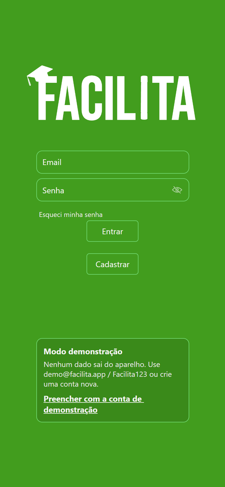
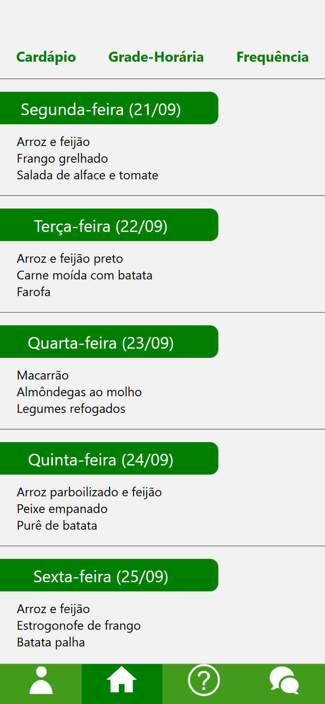
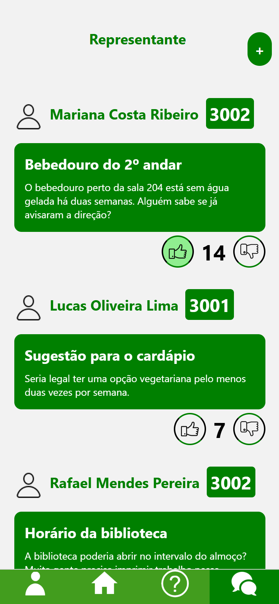
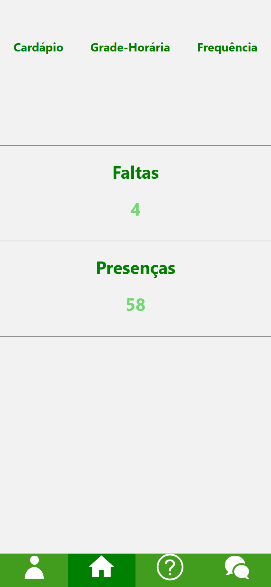
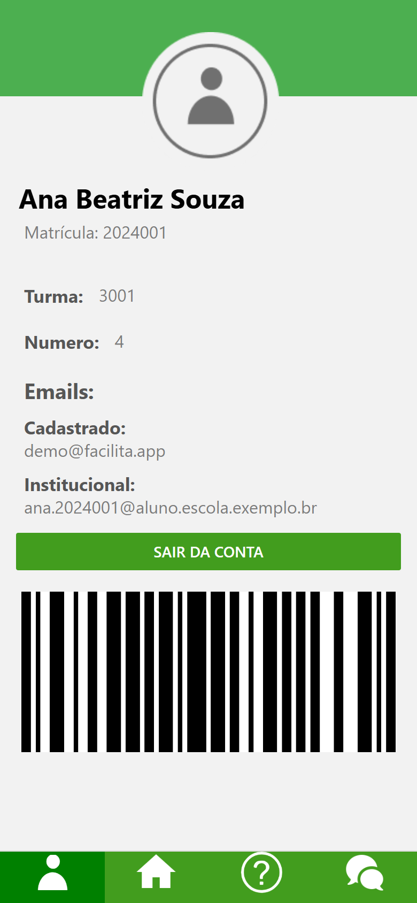
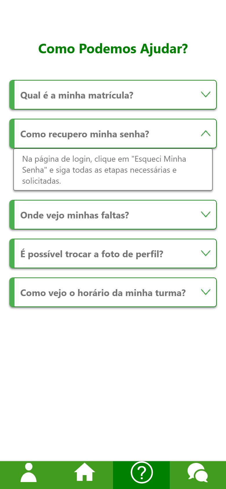
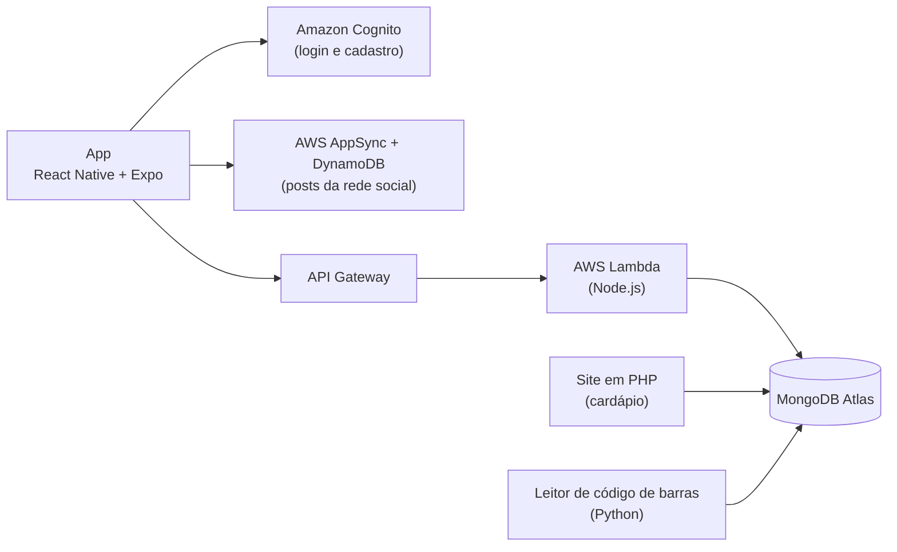

# Facilita

App escolar feito por uma equipe de alunos no último ano do ensino médio técnico, entre abril e outubro de 2024. Ele reúne em um só lugar o que a escola divulgava de formas pouco práticas: o cardápio da semana, a grade horária da turma, a frequência do aluno e um espaço para reclamações e sugestões.

> **Versão de demonstração.** O backend original (AWS e MongoDB Atlas) foi desligado depois do projeto. Esta versão roda sem servidor: o login, os dados e a rede social são simulados no próprio app, com a mesma lógica das funções originais. O código do backend continua no repositório, na pasta [`backend/`](backend).

<p align="center">
  
  
  
  
</p>
<p align="center">
  
  
  
</p>

## Como rodar

Precisa do [Node.js](https://nodejs.org) 20.19 ou mais recente.

```bash
npm install
npm start
```

Depois é só abrir no navegador (tecla `w`) ou no celular com o app [Expo Go](https://expo.dev/go), lendo o QR code.

**Conta de demonstração:** `demo@facilita.app` / `Facilita123` (tem um botão na tela de login que preenche). Também dá para criar uma conta com as matrículas `2024002`, `2024003` ou `2024004`. Os códigos de confirmação e de recuperação de senha são sempre `123456`.

Os dados ficam só na memória: ao recarregar o app, tudo volta ao estado inicial.

## Funcionalidades

- **Cadastro e login** com confirmação por email e recuperação de senha
- **Cardápio da semana**, cadastrado pela escola em um site próprio
- **Grade horária** da turma do aluno, com matéria e professor de cada tempo
- **Frequência**, com faltas e presenças registradas por um leitor de código de barras na entrada da escola
- **Perfil** com os dados do aluno, os emails e o código de barras da carteirinha
- **Rede social** para reclamações e sugestões, com votos; só o representante de turma pode publicar
- **Perguntas frequentes**

## Como o sistema funcionava

O app era só uma parte. A escola cadastrava o cardápio num site em PHP, e um programa em Python lia o código de barras das carteirinhas na entrada para registrar a presença.



| Parte | Tecnologia | Onde está |
| --- | --- | --- |
| App | React Native, Expo, Expo Router | raiz do repositório |
| Autenticação e rede social | AWS Amplify Gen 2 (Cognito, AppSync, DynamoDB) | [`backend/amplify`](backend/amplify) |
| API de dados | AWS Lambda + API Gateway, MongoDB Atlas | [`backend/lambdas`](backend/lambdas) |
| Cadastro do cardápio | PHP + MongoDB | [`backend/admin-cardapio`](backend/admin-cardapio) |
| Leitor de frequência | Python | não incluído |

No modo demonstração, [`services/auth.ts`](services/auth.ts) faz o papel do Cognito, com as mesmas funções e os mesmos nomes de erro do Amplify, e [`services/api.ts`](services/api.ts) faz o papel da API Gateway, com cada rota reproduzindo uma Lambda. Por isso as telas e os hooks do app são praticamente os mesmos de 2024.

## Estrutura

```
app/                  telas (Expo Router)
  (telasIniciais)/    login, cadastro, confirmação e recuperação de senha
  (mainScreen)/       abas: perfil, início, ajuda e rede social
components/           componentes reaproveitados (botão, barra de navegação, alertas...)
hooks/                lógica de login, cadastro e busca de dados
services/             backend simulado do modo demonstração
backend/              código do backend original
styles/               estilos compartilhados
```

## O que mudou nesta revisão (2026)

A versão exatamente como foi entregue está na tag [`v1.0-original-2024`](https://github.com/Thiago-Caffaro/Facilita/tree/v1.0-original-2024), e a branch da rede social está em [`v1.1-rede-social-2024`](https://github.com/Thiago-Caffaro/Facilita/tree/v1.1-rede-social-2024).

- Juntei a branch da rede social, que tinha ficado de fora da versão principal
- Removi uma chave de acesso da AWS que estava escrita no código (ela já foi desativada)
- Troquei o backend desligado pelo modo demonstração
- Atualizei do Expo SDK 51 para o 57 (React Native 0.86, React 19)
- Corrigi bugs encontrados ao testar tudo de novo: a grade horária não carregava na branch da rede social, a contagem de votos tirava votos de outros alunos, os alertas quebravam com erros desconhecidos, entre outros (o detalhe está no histórico de commits)

## O que eu faria diferente hoje

Olhando o projeto com mais experiência, estas são as principais lições:

- **Nunca colocar credenciais no app.** Qualquer pessoa consegue extrair o código de um aplicativo publicado. A troca de atributos de administrador no Cognito deveria rodar numa Lambda, com permissão dada por uma role do IAM.
- **Não guardar senhas em texto puro.** As Lambdas `login` e `addUser`, de uma versão anterior ao Cognito, salvavam e comparavam a senha direto no MongoDB. O certo é usar um hash como bcrypt, ou deixar tudo com o Cognito, como o app acabou fazendo.
- **Não devolver segredos na resposta da API.** A Lambda `enviarEmail` devolvia o código de recuperação para o app, e o código era previsível (`matrícula × horário`).
- **Proteger a API.** As rotas do API Gateway não exigiam login: qualquer pessoa podia consultar os dados de qualquer matrícula. Um autorizador do Cognito resolveria.
- **Modelar a frequência de outro jeito.** O total de dias letivos era calculado contando as presenças de uma "matrícula de referência" fictícia. Uma coleção de dias letivos seria mais simples e confiável.
- **Simplificar a recuperação de senha.** O fluxo troca a senha por uma temporária, faz login e depois pede a nova senha. O Amplify já permite enviar o código e a nova senha num passo só.
- **Um só lugar para o estado global.** Cada grupo de telas criava seu próprio `AuthProvider`, então o estado não era compartilhado como parecia.

## Equipe

Projeto desenvolvido por Thiago Caffaro, com Pedro Henrique Rodrigues, Kaua e Jiatsu.
